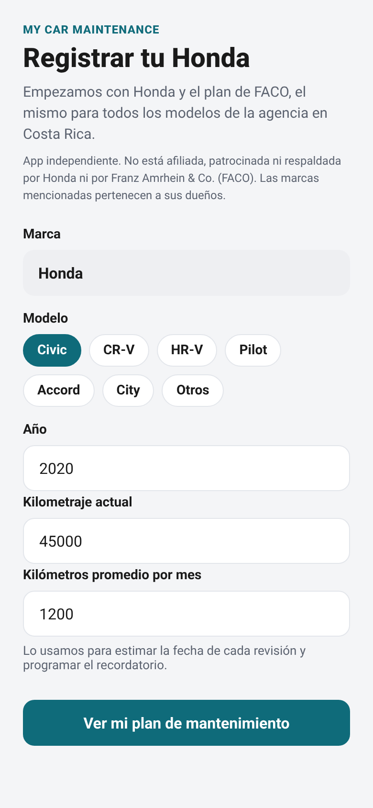
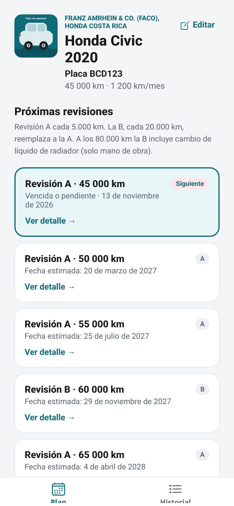
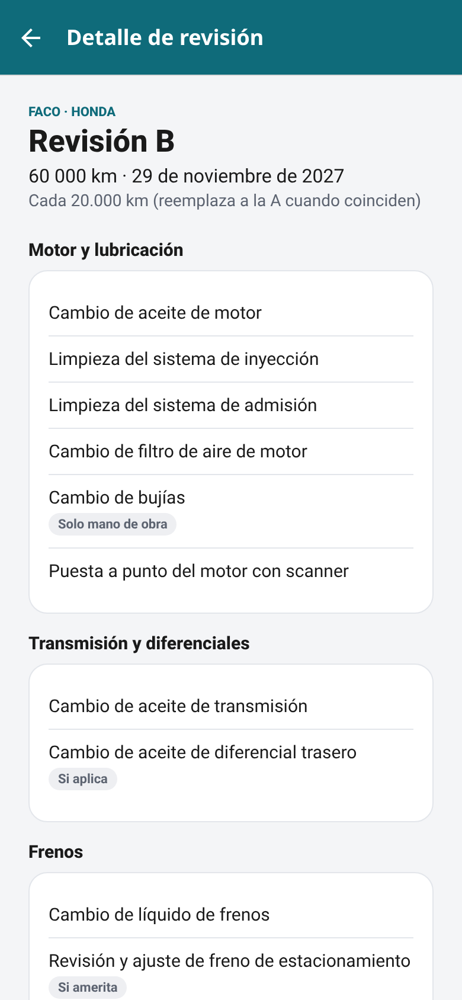
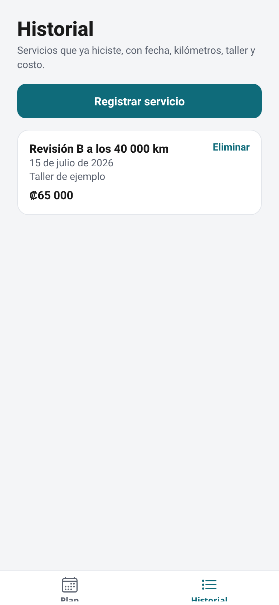

# My Car Maintenance

App en español para llevar el plan de mantenimiento de tu carro. El primer plan soportado es el de Honda según la agencia **FACO** (Franz Amrhein & Co.) en Costa Rica. El plan es el mismo para todos los modelos Honda de la agencia.

> App independiente. No está afiliada, patrocinada ni respaldada por Honda ni por Franz Amrhein & Co. (FACO). Las marcas mencionadas pertenecen a sus dueños.

Está hecha con **Expo** y **React Native** en TypeScript. Podés generar un APK de Android sin escribir código nativo.

## Qué hace

1. **Registrar carro.** Por ahora la marca queda fija en Honda. Elegís el modelo (Civic, CR-V, HR-V, Pilot, Accord, City u otros), el año, el kilometraje actual y los kilómetros promedio por mes. También podés agregar el número de placa y hasta 6 fotos opcionales del carro.
2. **Plan.** Lista las próximas revisiones por kilometraje, con fecha estimada según lo que manejás al mes. La siguiente revisión va destacada.
3. **Detalle de revisión.** Tareas agrupadas por área, con las marcas *si aplica*, *solo mano de obra* y *si amerita*. En la Revisión B también se listan los repuestos incluidos.
4. **Historial.** Registrás servicios hechos (fecha, km, taller, costo y hasta 5 fotos opcionales, por ejemplo la factura o un escaneo) en el teléfono, con AsyncStorage.
5. **Recordatorio.** Programa una notificación local para la fecha estimada de la próxima revisión (`expo-notifications`).

### Plan de mantenimiento soportado: Honda (FACO, Costa Rica)

- **Revisión A** (Servicio Express) cada **5.000 km**.
- **Revisión B** cada **20.000 km**. Cuando coincide con una A, la B la reemplaza.
- A los **80.000 km** (y múltiplos), la B incluye cambio de líquido de radiador (solo mano de obra).


## Capturas de pantalla

Estas capturas son de la versión web, con datos de ejemplo (Honda Civic 2020, placa BCD123, 45.000 km, 1.200 km/mes y una foto de ejemplo).

<table>
  <tr>
    <td align="center" valign="top" width="25%">
      
      <br /><sub>Registrar el carro, con placa y foto</sub>
    </td>
    <td align="center" valign="top" width="25%">
      
      <br /><sub>Plan de mantenimiento, con placa y foto</sub>
    </td>
    <td align="center" valign="top" width="25%">
      
      <br /><sub>Detalle de una Revisión B</sub>
    </td>
    <td align="center" valign="top" width="25%">
      
      <br /><sub>Historial de servicios</sub>
    </td>
  </tr>
</table>

## Cómo correrla

Necesitás Node.js 18 o superior y la app **Expo Go** en el teléfono.

```bash
git clone https://github.com/fabiobenavides/my-cr-honda-maintenance.git
cd my-cr-honda-maintenance
npm install
npx expo start
```

Escaneá el código QR con Expo Go (Android) o con la cámara (iPhone). También podés pulsar `a` para abrir el emulador de Android si lo tenés instalado.

## Cómo generar el APK (sin código nativo)

El perfil `preview` de EAS produce un APK que podés instalar en el teléfono.

```bash
npm i -g eas-cli
eas login
eas build -p android --profile preview
```

La primera vez EAS te va a pedir crear el proyecto en tu cuenta de Expo. Cuando termine, te da un enlace para descargar el APK.

El paquete de Android es `com.fabiobenavides.mycarmaintenance`. Este identificador hay que dejarlo definido **antes de publicar por primera vez en Google Play**, porque después no se puede cambiar.

## Scripts

```bash
npm start          # npx expo start
npm test           # pruebas unitarias de la lógica de calendario
npm run typecheck  # npx tsc --noEmit
```

## Estructura del proyecto

```
App.tsx                      # Navegación (registro, plan, detalle, historial)
app.json                     # Configuración de Expo y paquete de Android
eas.json                     # Perfil preview → APK
src/data/faco-honda.ts       # Plan FACO, pensado para sumar otras marcas después
src/lib/schedule.ts          # Lógica pura: qué revisión toca y fechas estimadas
src/lib/schedule.test.ts     # Pruebas Jest
src/lib/storage.ts           # Persistencia local con AsyncStorage
src/lib/notifications.ts     # Recordatorio de la próxima revisión
src/screens/                 # Pantallas en español
src/context/AppContext.tsx   # Vehículo e historial
```

Los datos del plan están separados de la interfaz: `brand` / `dealer` → plan. Más adelante se pueden agregar otras agencias o marcas sin reescribir las pantallas.

## Notas

- Las fechas se muestran en español de Costa Rica (`es-CR`, zona `America/Costa_Rica`).
- Los costos del historial van en colones (₡).
- El recordatorio pide permiso de notificaciones. Si lo denegás, el plan y el historial siguen funcionando.
- En la web, las fotos se guardan en el almacenamiento del navegador, que es limitado. Las imágenes muy grandes se reducen al guardarlas; aun así, varias fotos pueden llenar ese espacio. En el celular no pasa eso.
- Esta app no sustituye el criterio del taller; es una guía del plan publicado por la agencia.

## Features (English summary)

> Independent app. Not affiliated with, sponsored by, or endorsed by Honda or Franz Amrhein & Co. (FACO). Trademarks belong to their respective owners.

- **Register a car.** Honda is the only supported brand for now. Choose the model (Civic, CR-V, HR-V, Pilot, Accord, City, or other), year, current mileage, and average kilometers per month. You can also add a license plate number and up to 6 optional photos of the car.
- **Maintenance plan.** Upcoming FACO-style Honda services by mileage, with an estimated date based on monthly driving. The next service is highlighted.
  - Revision A (Express Service) every 5,000 km.
  - Revision B every 20,000 km. When it coincides with an A, B replaces it.
  - Every 80,000 km (and multiples), Revision B includes a radiator coolant change (labor only).
- **Revision detail.** Tasks grouped by area, with flags such as *if applicable*, *labor only*, and *if warranted*. Revision B also lists included parts.
- **Register a service.** Log completed work (date, mileage, workshop, and cost in Costa Rican colones) with up to 5 optional photos, such as an invoice, a scan, or a test result.
- **Service history.** Review past services, open photos in a full-screen viewer, and delete records (including on web).
- **Reminder.** On Android and iOS, schedules a local notification for the estimated date of the next service (`expo-notifications`). Reminders are not scheduled on web.
- **Local storage.** Vehicle and history are saved on the device with AsyncStorage.
- **Built with Expo and React Native** (TypeScript), for Android, iOS, and web.
